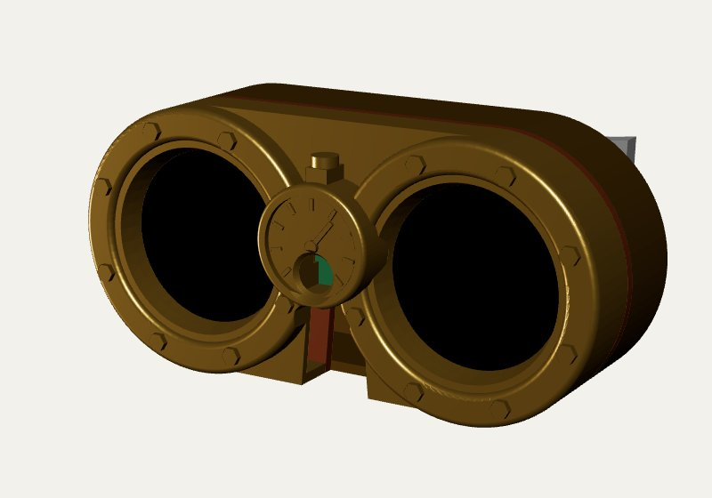
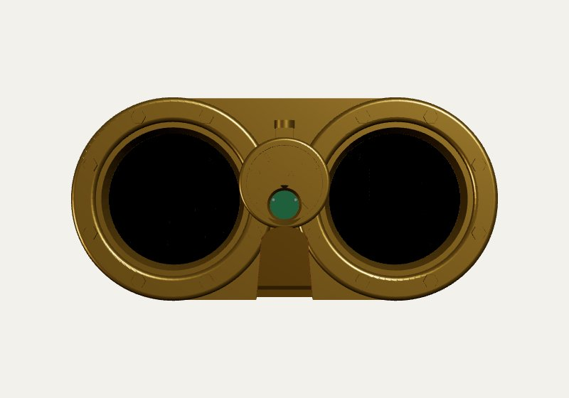
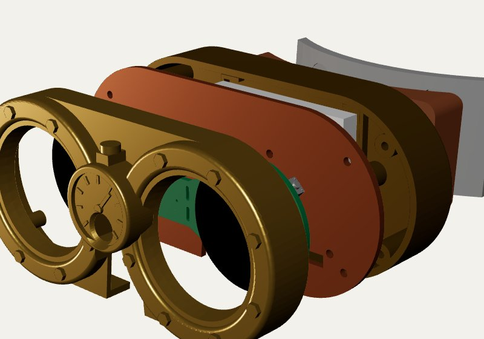
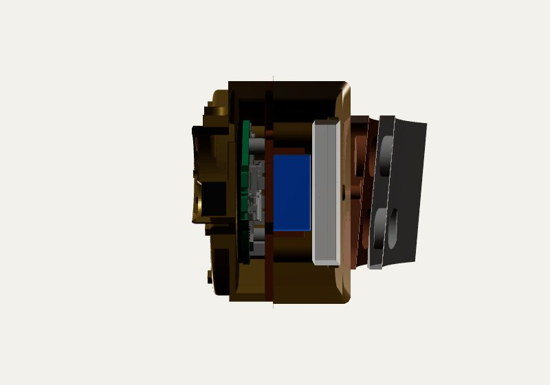
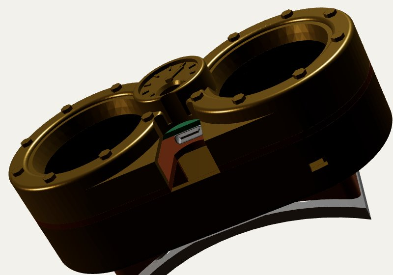

# Steampunk-Brille (Gehäuse)

Gehäuse für die beiden Augen-Displays und die Kamera, als Steampunk-Brille für einen Zylinder.
Look: Bullaugen mit Manometer (Skizzen-Variante D). Halterung: Magnete durch die Hutwand (Variante C).

| | |
| --- | --- |
|  |  |
|  |  |

## Dateien

- `brille.py`: parametrisches CadQuery-Modell. `pip install cadquery`, dann `python brille.py`.
  Das Skript schreibt alle Teile als STL und STEP nach `out/`, dazu eine Baugruppe `brille_assembly.step`.
- `out/`: druckfertige STL- und STEP-Dateien.
- Die Herstellermodelle (Waveshare-Board, XIAO) liegen nicht im Repo. Download-Links stehen im Abschnitt Quellen.

## Teile

| Teil | Masse (mm) | Druck |
| --- | --- | --- |
| `front`: Bullaugen, Display-Fenster, Manometer mit Kamerafach | 109 × 52 × 17 | Front nach oben, Stützen nur im Kamerafach und im USB-Bogen |
| `carrier`: Trägerplatte, hält Board und XIAO | 109 × 52 × 9 | flach, XIAO-Halter nach oben, keine Stützen. Gut in Kupfer |
| `back`: Rückdeckel mit Akkufach und Schalter | 109 × 52 × 18 | offene Seite nach oben, keine Stützen |
| `saddle`: Hutsattel mit 4 Magneten, 5° geneigt | 76 × 36 × 14 | flache Seite aufs Bett |
| `counter`: Gegenplatte innen im Hut, 4 Magnete | 76 × 36 × 18 | hochkant, auf der langen Kante |

PLA oder PETG, 0,2 mm Schichthöhe, 3 Perimeter. Messing-Optik zum Beispiel mit Silk-PLA oder mit Rub'n Buff auf mattem Schwarz.

## Material

- 4× Schraube M2 × 12, Zylinderkopf: Rückdeckel → Trägerplatte → Frontschale (selbstschneidend in 1,7-mm-Löcher)
- 4× Schraube M2 × 5: Trägerplatte an die M2-Abstandsbolzen des Boards (4 mm lang, wie im Waveshare-Modell)
- 2× Einschmelzmutter M3 (Aussen-Ø 4) im Rückdeckel und 2× Schraube M3 × 12 für den Sattel
- 8× Neodym-Magnet 10 × 3 mm (N52): je 4 im Sattel und in der Gegenplatte, **Pole paarweise prüfen**
- LiPo 603450, ca. 1100 mAh, mit Schutzschaltung und Stecker GH1.25/MX1.25 2-polig
- Schiebeschalter SS12D00 (eingeklebt, unten im Rückdeckel), ins Plus-Kabel des Akkus
- Kabel mit SH1.0-Stecker 14-polig für P2 am Augen-Board: Pin 5 = 3V3, Pin 6 = GND → XIAO 3V3/GND

## Aufbau

1. Kamera ins Kamerafach hinter dem Zifferblatt legen, das Flex-Kabel durch den Kanal über dem Board-Steg nach hinten führen.
2. Board mit den Displays voran in die Frontschale legen.
3. Trägerplatte mit 4 × M2 × 5 an die Abstandsbolzen des Boards schrauben. XIAO in die Eckhalter hinten auf der Trägerplatte setzen und das Kamera-Flex einstecken.
4. Akku an den **oberen** 2-Pin-Stecker (BAT) anschliessen, USB-C zeigt dabei nach unten. **Polarität vorher messen.** Schalter ins Plus-Kabel löten.
5. Akku ins Fach des Rückdeckels legen, Rückdeckel aufsetzen, alles mit 4 × M2 × 12 verschrauben.
6. Sattel mit 2 × M3 an den Rückdeckel schrauben. Gegenplatte innen in den Hut legen, die Brille hält aussen.

Laden: über die USB-C-Buchse des Augen-Boards. Sie ist unten im Nasenbogen erreichbar.

## Anpassen

Die wichtigsten Parameter stehen oben in `brille.py`:

- `HAT_R`: Radius der Hutkrone vorne (87,5 mm, an Daniels Hut gemessen).
- `TILT`: Neigung nach unten (Standard 5°). Augen und Kamera schauen damit leicht auf die Passanten herunter.
- `DISP_FRONT`, `STANDOFF_L`: Display-Höhe vor der Platine und Länge der Abstandsbolzen. Wenn die Displays wackeln oder drücken, hier anpassen.
- `XIAO_T`, `BATT_*`: Platz für XIAO und Akku. Ein dickerer Akku macht nur den Rückdeckel tiefer.
- `CAM_*`: Grösse des Kamerafachs und Position der Linse.

## Quellen

- Waveshare ESP32-S3-DualEye-Touch-LCD-1.28: [Wiki](https://docs.waveshare.com/ESP32-S3-DualEye-Touch-LCD-1.28), [Structure-Paket mit STEP/DXF](https://files.waveshare.com/wiki/ESP32-S3-DualEye-Touch-LCD-1.28/ESP32-S3-DualEye-Touch-LCD-1.28-Structure.zip), [Schaltplan](https://files.waveshare.com/wiki/ESP32-S3-DualEye-Touch-LCD-1.28/ESP32-S3-DualEye-LCD-1.28-Schematic.pdf)
- Seeed XIAO ESP32S3 Sense: [Wiki](https://wiki.seeedstudio.com/xiao_esp32s3_getting_started/), [3D-Modell](https://files.seeedstudio.com/wiki/SeeedStudio-XIAO-ESP32S3/res/seeed-studio-xiao-esp32s3-sense-3d_model.zip)
